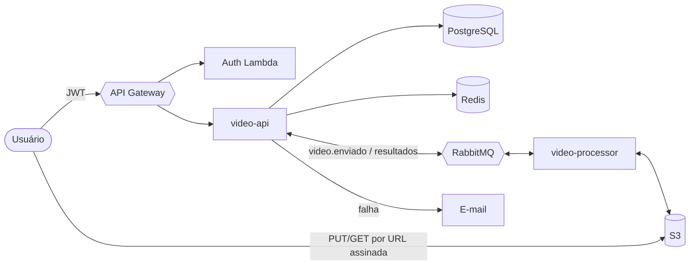

# FIAP X — Video API

API do FIAP X, o sistema de processamento de vídeos do Hackathon da Fase 5 (SOAT/FIAP). O usuário
envia vídeos, acompanha o processamento e baixa um `.zip` com os frames. Este serviço registra os
envios, coloca os vídeos na fila, mostra o status e avisa o usuário por e-mail quando algo falha. A
extração dos frames fica no [`fiapx-video-processor`](../fiapx-video-processor).

## Arquitetura



1. `POST /videos` registra o vídeo e devolve uma URL assinada para enviar o arquivo direto ao S3.
2. O cliente envia o arquivo e chama `POST /videos/{id}/confirmar-envio`.
3. A API confere o arquivo no S3 e grava `video.enviado` no outbox, na mesma transação do status.
4. O worker processa e publica `video.processado` ou `video.falhou`; a API atualiza o status e, na
   falha, envia o e-mail.
5. `GET /videos` lista os vídeos com status e `GET /videos/{id}/download` gera a URL do zip.

As decisões e os motivos estão nas [ADRs](docs/adr/README.md). O contrato HTTP está em
[`docs/openapi.json`](docs/openapi.json) e no Swagger em `/docs`.

## Rodar localmente

Requisitos: Docker e Node.js 22.

```bash
cp .env.example .env          # troque o JWT_SECRET
docker compose up -d --build  # PostgreSQL, RabbitMQ, Redis, LocalStack (S3), Mailpit e a API
```

| Serviço                   | Endereço                                     |
| ------------------------- | -------------------------------------------- |
| API e Swagger             | http://localhost:3000/docs                   |
| RabbitMQ                  | http://localhost:15672 (fiapx / fiapx_local) |
| Caixa de e-mail (Mailpit) | http://localhost:8025                        |
| S3 (LocalStack)           | http://localhost:4566                        |

Enquanto o `fiapx-auth-lambda` não está no Compose, gere um token de teste:

```bash
TOKEN=$(npx tsx scripts/gerar-token.ts ana@fiapx.dev)

# 1. registra o vídeo
curl -s -X POST localhost:3000/videos -H "authorization: Bearer $TOKEN" \
  -H 'content-type: application/json' \
  -d "{\"nomeArquivo\":\"aula.mp4\",\"contentType\":\"video/mp4\",\"tamanhoBytes\":$(stat -c%s aula.mp4)}"

# 2. envia o arquivo para a envio.url devolvida
curl -X PUT -H 'content-type: video/mp4' --data-binary @aula.mp4 "<envio.url>"

# 3. confirma e acompanha
curl -s -X POST localhost:3000/videos/<id>/confirmar-envio -H "authorization: Bearer $TOKEN"
curl -s localhost:3000/videos -H "authorization: Bearer $TOKEN"
```

Sem o worker rodando, `video.enviado` fica guardado no outbox até existir uma fila para recebê-lo.

## Testes e qualidade

```bash
npm test                  # tudo, com cobertura mínima de 80%
npm run test:unit         # só unitários, sem Docker
npm run test:integration  # HTTP + Testcontainers (PostgreSQL, RabbitMQ, LocalStack)
npm run lint && npm run typecheck && npm run format:check
```

| Camada         | Onde                      | O que cobre                                                                                                     |
| -------------- | ------------------------- | --------------------------------------------------------------------------------------------------------------- |
| Unitários      | `tests/unit`              | Entidade `Video`, casos de uso com dublês em memória, contratos de mensagens, adaptadores                       |
| HTTP           | `tests/integration/http`  | Rotas reais com `inject`: fluxo completo, autenticação, isolamento entre usuários, validação, limites           |
| Infraestrutura | `tests/integration/infra` | PostgreSQL (outbox, rollback, idempotência, relay em paralelo), RabbitMQ (retentativa e DLQ), S3 (URL assinada) |

O CI roda ainda CodeQL, `npm audit`, gitleaks, hadolint, Trivy e SonarQube Cloud
([ADR 0007](docs/adr/0007-qualidade-e-seguranca-na-esteira.md)).

## Estrutura

```
src/
  domain/          entidade Video, contratos das mensagens e portas (interfaces)
  application/     casos de uso
  infrastructure/  Prisma, outbox, RabbitMQ, S3, e-mail, Redis
  presentation/    rotas HTTP e autenticação
  container.ts     raiz de composição
prisma/            schema e migrations (script de criação do banco)
docs/adr/          decisões de arquitetura
```

## Variáveis de ambiente

Validadas na inicialização por [`src/config/env.ts`](src/config/env.ts); o
[`.env.example`](.env.example) traz os valores locais. Em produção, os segredos (`JWT_SECRET`,
`DATABASE_URL`, `RABBITMQ_URL`, SMTP) vêm de Kubernetes Secrets preenchidos pelo pipeline.
